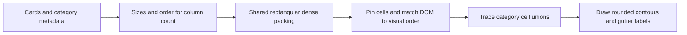

# Site architecture

The site is static HTML, CSS and browser modules, served from the repository root with no build step. Each application owns its inputs, computation and exports; shared navigation connects its entry page to the collection. Setup and application interfaces are documented in [README.md](../README.md).

Collection navigation is static markup inside each application's native header. `shared/tool-nav.css` provides compact links and header action groups; `shared/tool-nav.js` opens existing explanation sections or dialogs. Applications that already have a help button keep it. The benchmark's generated role pages inherit its canonical header, and Wanderwart's standalone/native builders synchronize local copies of the navigation assets. The newer tools also share `shared/base.css` for compact surfaces, themes, controls and responsive touch targets; application styles own their working layouts.

`shared/history.js` owns bounded Undo/Redo stacks and keyboard routing for the newer tools. App adapters copy editable values and keep immutable results and image assets by reference; restore cancels pending work before replacing page state. Form changes checkpoint at the end of a gesture, while focused text and number inputs retain native Undo. Signature keeps its pad-specific history, and b64 and the benchmark retain their existing implementations. The teaching pages use their canonical request/load interface, including explicit seeds, so a restored simulation uses the same parameters. Playback and worker progress do not create history entries.

## Landing layout

`index.html` supplies the cards, their sizes and subject categories. `style.css` chooses the column count and track sizing. The cards stay in one grid; theme boundaries do not take part in layout.

`assets/landing-order.js` holds curated sizes and placement orders by column count. Every order must name each card exactly once and fill a rectangle. A tile can gain a row or widen to complete the bottom edge. Statistics includes the visualization tools; the salary benchmark is in Everyday tools. This keeps desktop categories connected without a runtime optimiser; the browser regression checks the resulting packing, connectivity and density. A single column uses the thematic source order. Changing the card set or its spans requires reviewing these arrangements.

`shared/mosaic.js` performs deterministic row-dense placement, validates the full rectangle, pins cells and normalises DOM order while retaining keyboard focus. Phone and short landscape layouts use content-height rows; their last card expands into unused columns. Both the landing page and the 15-entry Intuitions gallery use this helper with their own arrangements. `assets/landing.js` owns lazy artwork loading and reduced-motion-aware hover playback. A resize observer responds to both breakpoint changes and actual track-height changes.

`assets/cluster-contours.js` is DOM-free geometry: it removes shared cell edges and traces separate outer and hole boundaries. `assets/landing-clusters.js` maps those lattice coordinates to measured grid tracks, insets boundaries within the gutters to separate neighbouring colours, and draws rounded SVG paths. Labels sit on suitable top edges, clear of cards. SVG and labels ignore pointer events and are decorative for assistive technology; category names are also attached to card descriptions.

The contour geometry operates only on the landing layout. It does not change application data, models or artwork. Forecast Calibration is linked from the Intuitions gallery and retains its standalone route and API.

With JavaScript unavailable, the semantic card links and thematic source order remain available through ordinary CSS placement.
