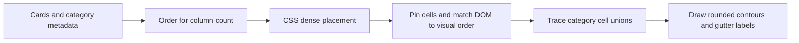

# Site architecture

The site is static HTML, CSS and browser modules, served from the repository root with no build step. Each application owns its inputs, computation and exports; shared navigation connects its entry page to the collection. Setup and application interfaces are documented in [README.md](../README.md).

## Landing layout

`index.html` supplies the cards, their sizes and subject categories. `style.css` chooses the column count and tile spans. The cards stay in one grid; theme boundaries do not take part in layout.

`assets/landing-order.js` holds curated placement orders by column count. Every order must name each card exactly once. This keeps desktop categories connected without a runtime optimiser; the browser regression checks the resulting packing, connectivity and density. A single column uses the thematic source order. Changing the card set or its spans requires reviewing these arrangements.

`assets/landing.js` lets CSS place the cards, pins the resulting cells and normalises DOM order while retaining keyboard focus. It also owns lazy artwork loading and reduced-motion-aware hover playback. A resize observer responds to both breakpoint changes and actual track-height changes.

`assets/cluster-contours.js` is DOM-free geometry: it removes shared cell edges and traces separate outer and hole boundaries. `assets/landing-clusters.js` maps those lattice coordinates to measured grid tracks, insets boundaries within the gutters to separate neighbouring colours, and draws rounded SVG paths. Labels sit on suitable top edges, clear of cards. SVG and labels ignore pointer events and are decorative for assistive technology; category names also appear in navigation and card descriptions. Theme links target the first card in their category after each reflow.

The geometry operates only on the landing layout. It does not change application data, models or artwork. With JavaScript unavailable, the semantic card links and thematic source order remain available through ordinary CSS placement.
