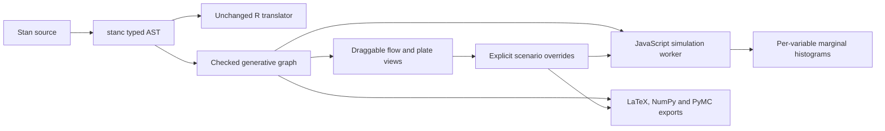
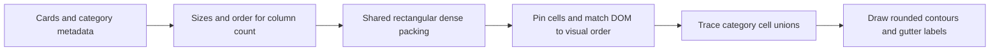

# Site architecture

The site is static HTML, CSS and browser modules, served from the repository root with no build step. Each application owns its inputs, computation and exports; the landing page links the public tools. Setup and application interfaces are documented in [README.md](../README.md).

Applications keep their native headers without an added collection-link row. `shared/tool-nav.css` provides compact header action groups and in-page explanation styles; `shared/tool-nav.js` opens directly linked explanation sections. The benchmark's generated role pages inherit its canonical header. The newer tools also share `shared/base.css` for compact surfaces, themes, controls and responsive touch targets; application styles own their working layouts.

The landing page and Wanderwart use the same `shared/light-switch.js` and stylesheet. The landing theme switch plugs into `shared/theme.js`; motion retains its own persisted preference, defaulting to reduced-motion settings until the visitor explicitly chooses on or off. Wanderwart's shell/native builders synchronize local copies of the shared component and header styles, preserving a standalone module graph and offline cache. Bundle tests verify byte parity and exercise local pages with external requests blocked.

`shared/history.js` owns bounded Undo/Redo stacks and keyboard routing for the newer tools. App adapters copy editable values and keep immutable results and image assets by reference; restore cancels pending work before replacing page state. Form changes checkpoint at the end of a gesture, while focused text and number inputs retain native Undo. Signature keeps its pad-specific history, and b64 and the benchmark retain their existing implementations. The teaching pages use their canonical request/load interface, including explicit seeds, so a restored simulation uses the same parameters. Playback and worker progress do not create history entries.

Seating exposes two explicit computation paths through `runRequest`: the existing static `submit` and the nominal-category `planRounds` scheduler. The worker, browser API and CLI share that dispatcher. Round results retain assignments, objective terms and raw/weighted travel diagnostics; the UI, selected-round SVG and all-round CSV use those stored assignments. See [the request and objective contracts](../seating/api.md).

The Figure Editor reads controls into a project snapshot before calling its DOM-free code generator. autoCHAIR can calculate intervals and render an agenda from an explicit state and timestamp independently of browser persistence. Wanderwart's studio and sheet API share the defaults, loader-backed sheet context and layout solver, and b64's JSON adapter calls the same transform as its editor worker. Each tool's CLI accepts the browser request format.

## Alphabet and logo editors

`motrpac-alphabet/` preserves the original SVG shape editor and hand-tuned A–Z seed registry. Its font adapter reads the same transformed SVG contours, then `font-export.js` writes a TrueType font with optional COLR/CPAL colour layers and ordinary fallback outlines. Browser-native geometry supplies the contours; the font writer itself is callable without a DOM. The neighboring `mattlab/` painter retains its supplied geometry, project model, colour engine and sheet exporter as separate modules; its API and CLI call those same exporters. The editors have independent saved-project formats and histories, connected by the same shared lightswitch at the start of their native headers.

## Stan Studio (`stan2r/`)

`stan2r/` runs the pinned Stan compiler in a worker. Browser and native adapters share `compilation.js`: current stanc 2.38 runs first; if needed, a lazily loaded official 2.32.2 compiler modernizes supported legacy syntax and 2.38 rechecks the result. Syntax metadata discloses migration and the normalized source; the original editor text is retained. The R path passes its typed AST to the unchanged hardened R translator in webR. A small R bridge replaces compiler/process I/O; it does not replace parsing or translation rules. The runtime downloads on the first valid conversion, and serialized requests share its virtual filesystem. The native CLI uses the same compiler, translator, request validation and bridge through `Rscript`. Vendored-source hashes record provenance. Generated code and warnings are returned together; changing inputs marks displayed output stale.

The explorer is a separate consumer of the same typed AST. `model.js` lowers a checked generative subset to a graph; `expressions.js` and `simulation.js` evaluate it with explicit domain, shape, normalization and resource checks. Independent full-range loops, including static group-index gathers, are normalized before simulation. `support.js` conservatively proves redundant transformed-parameter bounds; scenario edits recheck that proof and conditional prior normalization. Unsupported joint densities fail rather than becoming a different generative model. Original supplied observations are validated separately from replicated outcomes.

`explorer-browser.js` shares compilation with the R converter while the simulation worker stays independent of webR. `explorer-native.mjs` exposes identical graph/simulation/export operations through CLI actions. The interface debounces prior edits, ignores obsolete results, keeps original and current histograms on shared axes, and stores graph/scenario edits in the existing history. Diagram position is presentation state; explicit interventions leave source unchanged and are labeled in exports. Source/data edits invalidate the current exploration. There is no browser fitting backend or analytic-composition shortcut in this path. `pymc.js` generates a Python model with supplied observations and symbolic transforms, reusing the numeric expression emitter and validation helpers from the NumPy exporter. The generated model is validated in a pinned, isolated PyMC environment; fitting runs only when a user explicitly executes its fitting calls.

Stan Studio’s source/specification view shares its LaTeX equation generator with the export API; a pinned local KaTeX renderer produces native MathML. Equation selection links back to expandable graph nodes and source declarations. Node expansion and selection are navigation, while prior edits and positions participate in shared history. All exports live in one panel, with R explicitly translating original source and graph-based exports carrying the current scenario. Existing `/stan2r/` URLs and `window.Stan2R` callers remain valid alongside `window.StanTheExplorer` and `window.StanStudio`.

`diagram-projection.js` separates value/parameter-bound dependencies from size and declared data-bound inputs for the compact plate view. It groups repeated variables by symbolic dimension only when dependency paths preserve the element index; aggregate and gathered relationships remain explicit. `diagram-layout.js` gives the projected graph and measured card sizes to local ELK.js, then converts its compound-node coordinates and separate-port routes to SVG. Small crossing jumps and under-strokes distinguish intersecting edges. The complete flow view remains available. Layout requests use generation guards; manual drag offsets remain independent of automatic layout and simulation. Wide panes route left-to-right, narrow panes top-to-bottom. SVG zoom affects presentation and pointer/selection coordinate conversion only.

`workspace.js` owns panel visibility and dock resizing, independently of model history. CSS stacks the dock on narrow screens; resizing across the touch-control breakpoint remeasures expanded graph cards. Graph and histogram areas share the main pane; the distributions can collapse to reclaim height.

## Shared decoration editor

Name Tags embeds the standalone Helix editor in a modal. Same-origin, source-checked messages carry a validated draft; pending or invalid edits disable Apply. Apply creates one Name Tags history entry, while Cancel discards the draft. The shared Helix drawing API supplies filled geometry for uniform fitting into the existing reserved decoration box, leaving the default optimizer and underline gaps intact.

Helix’s optional path stage resamples and smooths an open guide through Signature’s shared numerical helpers, builds a checked tangent/normal frame, and maps the existing strand geometry along it. Curvature and nearby sections constrain band width, reported in the result and UI. The GUI, API and CLI use the same path validation and drawing pipeline; SVG styles and PNG export use that result. The original straight generators remain the default.

## Landing layout

`index.html` supplies the cards, their sizes and subject categories. `style.css` chooses the column count and track sizing. The cards stay in one grid; theme boundaries do not take part in layout.

`assets/landing-order.js` holds curated sizes and placement orders by column count. Every order must name each card exactly once and fill a rectangle. A tile can gain a row or widen to complete the bottom edge. Statistics includes the visualization tools; the salary benchmark is in Everyday tools. This keeps desktop categories connected without a runtime optimiser; the browser regression checks the resulting packing, connectivity and density. Everyday tools lead both the desktop mosaic and the single-column source order. Helix remains available through Name Tags and its standalone editor without a separate landing tile. Changing the card set or its spans requires reviewing these arrangements.

`shared/mosaic.js` performs deterministic row-dense placement, validates the full rectangle, pins cells and normalises DOM order while retaining keyboard focus. Phone and short landscape layouts use content-height rows; their last card expands into unused columns. Both the landing page and the 15-entry Intuitions gallery use this helper with their own arrangements. `assets/landing.js` owns lazy artwork loading and reduced-motion-aware playback. Desktop hover and keyboard focus select previews; narrow screens or coarse touch pointers use the card nearest the viewport centre, measured once per scroll/resize frame. A sticky bar on desktop and mobile controls persisted playback and theme preferences; hidden pages pause every player. A resize observer responds to both breakpoint changes and actual track-height changes.

Landing artwork gains `data-started` on its first interaction, keeping its CSS animations attached thereafter. `data-playing` controls whether their clocks run or pause, so pointer leave and keyboard blur retain the current frame. The Hypercube and Seating canvas players likewise retain their clocks and canvases, redrawing a paused frame only for a resize or theme change. Seating’s build pipeline runs the shared planner on `seating/examples/rounds-room.json`, computes and validates collision-free presentation routes offline, then emits a compact lossless motion file for lazy loading; the browser only draws those verified paths and camera views. The autoCHAIR player selects frames from a lossless strip sampled from the application’s original transparent logo movie. Agenda checkpoint times and the SVG timeline’s CSS clock drive each turn, so the agenda and chair pause and resume together without browser-dependent accelerated video playback. The Alice player uses its CSS clock to reveal exact word groups and update the SVG camera transform, keeping zoomed glyphs crisp. All players implement the same play/pause/destroy lifecycle. Without an explicit animation preference, reduced motion removes the animation state and canvas to show the authored still, including when a player download is pending. The switch remains operable, and an explicit on/off choice overrides the system default. CSS loops use the same JavaScript-controlled animation state so an explicit opt-in also enables SVG playback.

`assets/cluster-contours.js` is DOM-free geometry: it removes shared cell edges and traces separate outer and hole boundaries. `assets/landing-clusters.js` maps those lattice coordinates to measured grid tracks, insets boundaries within the gutters to separate neighbouring colours, and draws rounded SVG paths. Labels sit on suitable top edges, clear of cards. SVG and labels ignore pointer events and are decorative for assistive technology; category names are also attached to card descriptions.

The same contour paths supply the section fills, with category colours mixed into the active page background in CSS. Their even-odd fill keeps holes and interlocking categories separate. Container queries place the Photomosaic description beside its image (centred cropping fills the well while preserving square mosaic cells) in compact cards and the Figure Editor description beside its landscape preview when the tile is wide enough; the card remains one accessible link in the same reading order.

The contour geometry operates only on the landing layout. It does not change application data, models or artwork. Forecast Calibration is linked from the Intuitions gallery and retains its standalone route and API.

With JavaScript unavailable, the semantic card links and thematic source order remain available through ordinary CSS placement.

## Collage preview selection

`message-collage/core/whitespace.js` measures coverage and large blank rectangles from the same rotated/warped glyph boxes used by the renderer. It does not replace the app’s buffered-grid selection. `scripts/landing-art/collage-search.mjs` screens independent starts at three aspect ratios, finishes a small shortlist with the existing expansion/rotation/warp pipeline, and saves the selected results with source hashes and scoring provenance. The card builder consumes those results and shares glyph paths across the three compositions. Container queries select a composition for the actual preview well; each nested SVG preserves its own aspect ratio.

## Matrix Rain and Rating Prediction

Matrix Rain builds a seeded set of character streams, samples a scene at any point on its timeline and paints the resulting frame on Canvas. A separate seeded shuffle assigns hidden words to columns. The renderer caches the reflection’s edge image and scales the image and CRT mask with the same camera. Playback, PNG capture and browser video recording share the renderer. The landing preview uses a static SVG before playback. On playback it samples the same scene and Canvas renderer at the card’s aspect ratio, driven by its pausable animation clock. The JSON CLI can sample the timeline without a browser.

Rating Prediction opens at `/rating-prediction/`. Its modules, datasets and public API files live in `media-ratings/`, where the previous entry page forwards bookmarked catalogs to the new address. The app fits its Gaussian catalogs offline in R and serves their item labels, scale cutpoints, component weights, means and covariance matrices as static JSON. Its browser and Node entry points use the same normal interval functions and Cholesky factorization as Statistical Intuitions. The logit reference conditions on point observations. The ordinal model integrates over observed rating intervals, then combines component predictions using posterior class probabilities. [Model, data and evaluation](../media-ratings/README.md)

Rating Prediction also supports product-categorical latent classes. The R and Python fitters use sparse rating indicators for EM. The Reddit and AO3 catalogs model binary actions and include the observed absence of an action within their source cohorts. The browser performs exact discrete conditioning. The selection workflow partitions respondents, locks each family’s complexity on validation log loss, and scores the finalists on a reserved set of respondents. Catalog JSON carries the selected parameters and validation summaries. Each catalog ships marginal counts and exact pairwise co-ratings. Large ordinal tables use triangular blocks fetched when a comparison opens. AO3 uses one positive overlap per pair and the cohort marginals to reconstruct all four cells. Steam thumbs, Metacritic player scores and Amazon platform-edition stars use separate game catalogs and response histories. The Web fiction selector similarly keeps AO3 kudos separate from whole-star Kindle reviews. The Royal Road edition builder joins Kindle parent ASINs to Royal Road fiction IDs using a curated crosswalk. It fits individual Kindle reviews and ships aggregate probabilities and co-rating counts. The independent native Royal Road adapter accepts half-star review exports. On Metacritic, zero is a valid score. The 500-film fit streams every in-catalog rating from MovieLens 25M and fits the categorical and Gaussian summaries offline, with paired MovieLens small counts in a compressed triangular array. The prediction engine supplies the Gaussian projection from the same conditional factors. The categorical mixture supplies class information gains and a between-class PCA. The question ranking can weight information gain by the observed response fraction. Film exposure counts come from the full 25M matrix; destination exposure counts come from the Stravl marginals. A separate film table also supplies reported box office and production budgets for browsing. The ratings-and-tags film model shares the categorical weights and adds a kernel ridge adjustment from learned rating and tag features. The static catalog stores those features in item order and references the base fit by key. Steam games, books and anime fit corresponding similarity adjustments using ratings and their own collection metadata. The default film model reuses those features, a class-by-film table of title-choice log frequency ratios and the annual calibration. The API also exposes each adjustment individually. Each rating carries its source through draft edits, prediction and CSV exchange. Only volunteered identities update class weights alongside the stars.

Calendar calibration uses the submission dates carried by the workspace, CSV and JSON API. The packaged catalog includes annual per-film counts on the half-star scale. The scorer caches the resulting class distributions by year, conditions on each dated rating in its own year and uses the latest dated year for the forecast and its population comparison. Undated answers use the pooled distributions. [Calendar model and validation](../media-ratings/rating-dates.md)

Steam estimates a shared beta prior over per-game approval, then pools game and class-level review counts when fitting the approval predictor. Item annotations carry a 95% posterior interval for overall approval among the game's reviewers. A separate item-indexed table stores review frequencies and excess co-review counts. The discovery ranking blends predicted rating rank with shared-audience rank for games the user voluntarily selected. Other explicit-review catalogs can use metadata proximity and rating counts. The information panel computes a forecast for an already-rated item by omitting its own rating, date and selection evidence. [Steam approval fit](../media-ratings/game-catalog.md) · [Discovery evaluation](../media-ratings/discovery-study.md)

The fingerprint combines the active fit’s posterior weights with class-level distributions on the recorded scale. The fingerprint removes the overall rating level before projection by default. It computes posterior mean positions on all measurable axes and uses the selected pair for the map and its Gaussian covariance. The stacked axes pair these positions with separately scaled item loadings. Recurring catalog metadata labels a pole when its membership correlates with the loadings, with extreme titles as fallbacks. Item annotations also support recommendation filtering and group affinities. Static link tables keyed by catalog item ID hold direct film articles and destination map identities independently of the co-rating files. Respondent-disjoint experiments compare training sizes and content-aware predictions. CSV prediction snapshots stay separate from the active rating inputs.

Quick rate uses the same scorer and class-information calculations as the recommendation boards. Its candidate pool includes all unrated titles unless the user extends the recommendation filters to rating suggestions. It holds skips and revisions within the session, and merges completed answers into the draft as app suggestions when the dialog closes. A static recognition manifest keyed by verified article URL supplies display metadata. Film poster and fallback thumbnail requests go directly to Wikimedia when the card opens. Books, anime, TV shows and cocktail recipes carry external cover, poster or recipe-photo URLs. The expanded destination link table includes verified Wikimedia recognition images where available. [Model comparison](../media-ratings/predictor-comparison.md)
