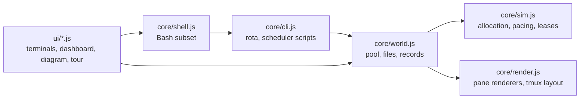

# ROTA demo

An interactive, simulated ROTA pool at `/rota/`: two shells, the `rota monitor` tmux dashboard and
a diagram of the pool, over a model of ROTA's coordinator that runs in the page. ROTA itself is at
[github.com/NikVetr/rota](https://github.com/NikVetr/rota); its explainer video is
[How the ROTA scheduler works](https://youtu.be/NRnLCDgYsQw). Nothing here contacts a cluster.

## How it is built



- `core/sim.js` steps the coordinator one simulated second at a time. Its allocation, start
  grants and pacing are a port of the explainer video's `sim.ts`, itself a compact port of
  `scheduler/adaptive_coordinator.py` (`allocate`, `_start_grants`, `_pace_start_grants`). On top
  of that it keeps leases (20 s), dependencies, admission (pause, resume, close), failure holds
  and share interruptions as the scheduler does. Simplifications, stated on the page: plans are
  acknowledged at once, there is no shared-I/O admission, live capacity equals the budget, and
  memory is charged at its declared amount.
- `core/cli.js` answers with the messages and `key=value` records of `rota`,
  `scheduler/adaptive_scheduler.sh`, `start_workers.sh` (submit), `reconcile_queue_batch.sh` and
  `monitor/monitor_pool_eta.py`. Setup commands, `rota kill`, `rota control` and a few others
  print a `demo:` note instead.
- `core/render.js` ports `monitor/render_queue_progress.sh`, `monitor/monitor_cpu.py`,
  `monitor/monitor_linux.py`, the cluster I/O panel and the tmux layout of
  `monitor/start_tmux_monitoring.sh`.
- `core/scenario.js` holds the sample data: `examples/cluster.json` (hosts `storage` and
  `worker`, root `/srv/cluster`), `examples/first-job`, and the `my-analysis` project with queues
  A, B and C. Job runtimes are invented.
- `ui/tour.js` is the guided tour. Pip, the black-and-white cat from the site's footer photo,
  leaps to each window it talks about, and the tour panel from `shared/tour-guide/` glides after
  it: Back and Next, dragged aside by pointer, touch or the arrow keys on its grip until Snap back.
  Under `prefers-reduced-motion` both appear there at once. `?tour=1` starts the tour, `?tour=0`
  suppresses it; otherwise it starts on a first visit.
- `guide/` holds Pip's poses, one SVG each, listed in `guide/manifest.js`. To use new art, replace
  a file under the same name or point the manifest at another; `shared/tour-guide/POSES.md` gives
  the poses the tour uses and the canvas they share.

## Scripting the page

`window.RotaDemo` drives the simulation for tests and scripts:

```js
RotaDemo.run('rota pool-status');            // {code, lines, stderr}, shown in the storage window
RotaDemo.run('ps', 'worker');                // the worker's shell
RotaDemo.advance(120);                       // simulated seconds
RotaDemo.cable(false);                       // pull the worker's cable; true reconnects
RotaDemo.state();                            // {t, pool, hosts[], queues[]} as plain data
RotaDemo.setSpeed(60); RotaDemo.setClock(false); RotaDemo.reset();
RotaDemo.tour.start(0); RotaDemo.tour.go(8); RotaDemo.tour.stop();
RotaDemo.dashboardText();                    // the dashboard as plain text
```

A JSON CLI would not be meaningful here: the page is a demonstration, not an analysis tool.

## Tests

```sh
node --test rota/tests/core.test.mjs                 # renderers against ROTA's, scheduler promises
node --test rota/tests/demo.browser.mjs              # Playwright: keyboard, tour, cable, phone
BROWSER_ENGINE=webkit node --test rota/tests/demo.browser.mjs
tsc -p rota/jsconfig.json
```

The browser tests need Playwright (`PLAYWRIGHT=<path to playwright>`). The renderer fixtures in
`tests/fixtures/` come from ROTA's own pure renderers; regenerate them from a ROTA checkout with
`ROTA_PUBLIC=<checkout> node rota/tests/capture-fixtures.mjs`. That script runs no scheduler.
