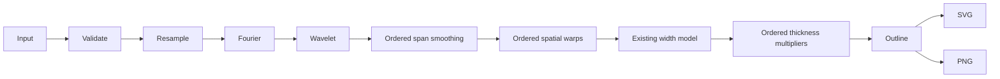

# Signature editing pipeline

`core/index.js:submit` is the shared computational entry point for the browser,
`window.Signature` and `cli.mjs`. `core/request.js` validates structured requests;
`core/input.js` reads strokes, CSV, matrix or SVG. No optional edit is inferred by
the API. Requests without `effects` or `warps` retain the original result shape
and numerical output.

`core/effects.js` owns the raw arc-length timeline, falloff, turn detection, optional
geometry edits, width multipliers and neutral initial suggestions. Spans remain
anchored to raw ink length throughout editing. Pen-lift gaps are synthetic (3% of
raw total ink length each), not elapsed time. Dots occupy a small finite span.

`editor.js` owns the timeline/bar interface, linked colours, active-region fading,
spatial-warp interaction and optional creation sequence. Geometry always comes
from `submit`; preview and export use its corrected points/outline. Display colours
and animation are presentation only. `app.js` coordinates settings, correction,
exports and target morphing. `pad.js` snapshots strokes, local brush regions, the
fitted view, effects, warps, output controls, application settings and the morph
target/settings for Undo/Redo. Monotonic history revisions and per-channel read
tokens discard stale asynchronous example/file reads after restoration, intervening
edits or newer requests. The shared `isTextEditor` predicate protects native text
editing while letting non-text controls use application shortcuts. A new history
branch clears Redo. Text editing keeps browser-native history.

Morphing retains the chosen Fourier, wavelet or corrected interpolation. Optional
source edits are applied to that method's source endpoint in its normalized
coordinates; the resulting displacement decays by `1-p`, and source thickness
multipliers participate in width interpolation. The target endpoint is unchanged.
The absence of optional edits skips this stage entirely.
